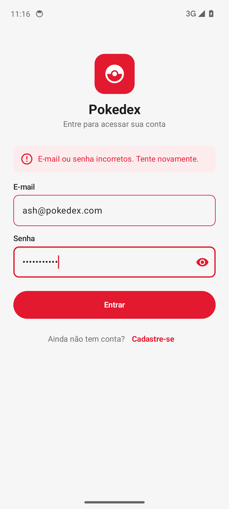
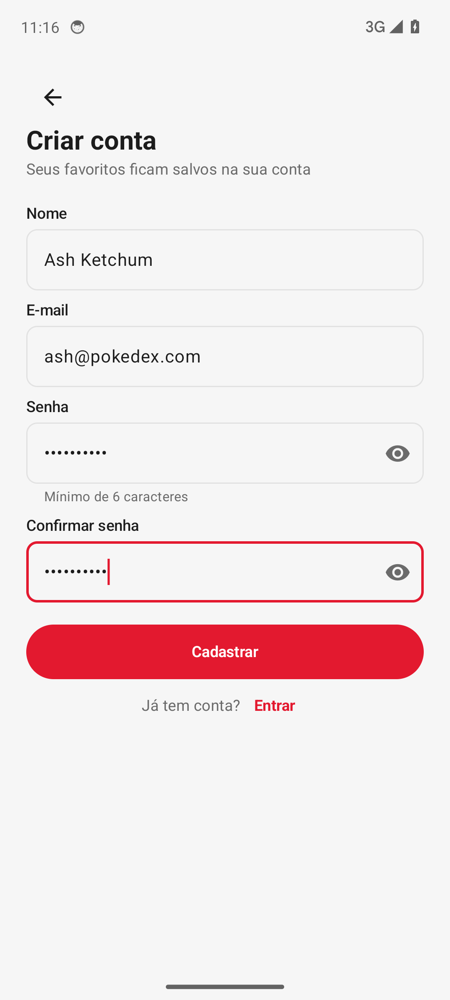
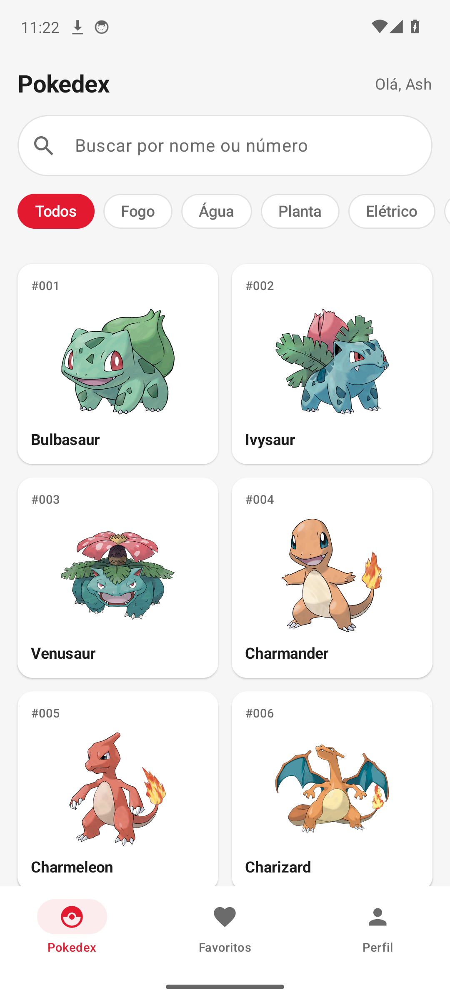
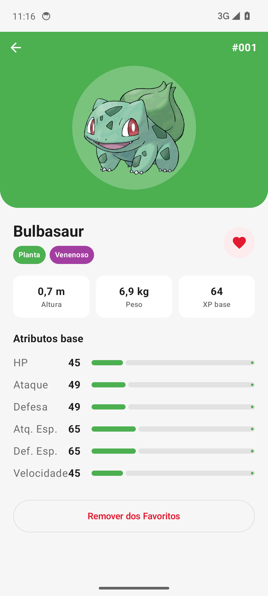
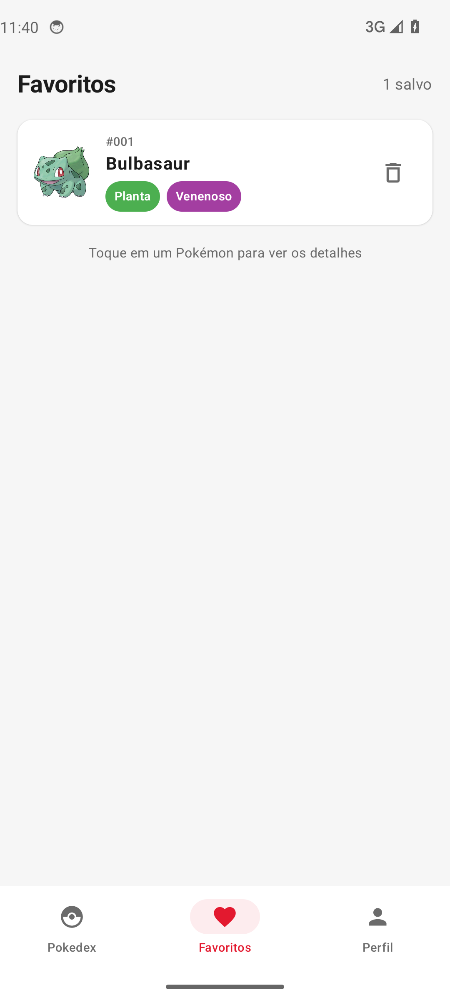
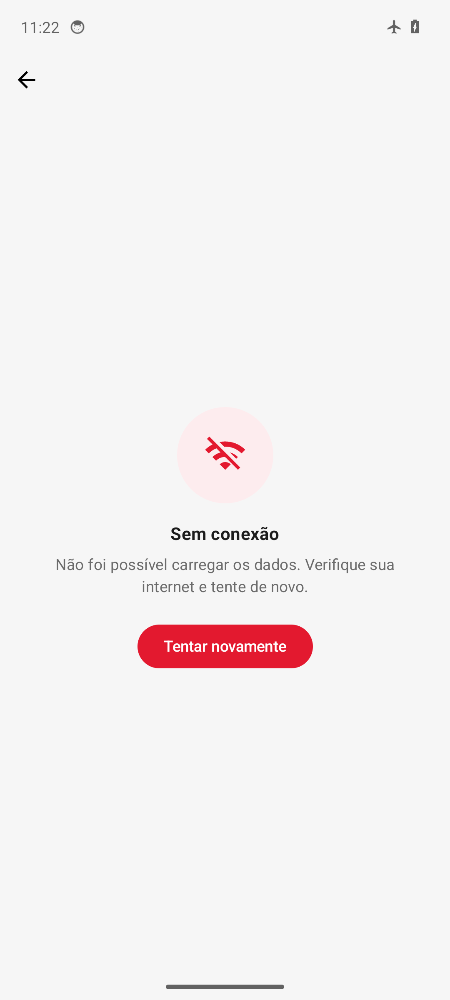

# Pokedex

App Android para consultar os 151 Pokémon da primeira geração, ver os detalhes de cada um e montar uma lista de favoritos que fica salva na conta de cada usuário.

## API utilizada

**PokéAPI** — `https://pokeapi.co/api/v2/` (pública, sem chave).

| Endpoint | Para que usamos |
|----------|-----------------|
| `GET pokemon?limit=151` | Lista da aba Pokedex (nome e número) |
| `GET pokemon/{id}` | Tela de detalhe: tipos, altura, peso, XP base e atributos base |
| `GET type/{nome}` | Filtro por tipo (Fogo, Água, Planta...) na lista |

As imagens vêm do repositório oficial de sprites da PokéAPI (`official-artwork`).

## Como o app atende aos requisitos

| Requisito | Onde está |
|-----------|-----------|
| API REST com Retrofit e coroutines | `network/PokeApiService.kt`, `network/RetrofitInstance.kt`, `data/PokemonRepository.kt`. As telas mostram carregando, sucesso e erro (`ListaEstado`, `DetalheEstado`). |
| Login e sessão | `data/UsuarioRepository.kt` (validação e hash SHA-256 da senha), `data/SessionManager.kt` (id do usuário em SharedPreferences, por isso continua logado ao reabrir). Botão **Sair da conta** na aba Perfil. |
| Persistência local (Room) | `data/Entidades.kt` (`Usuario`, `Favorito`), `data/Daos.kt`, `data/PokedexDatabase.kt`. Favoritos têm chave (usuarioId, pokemonId), então cada conta só vê os seus. |
| Navegação | `userinterface/Navegacao.kt`: Navigation Compose, barra inferior com 3 abas (Pokedex, Favoritos, Perfil) e rota type-safe `DetalheRoute(pokemonId)`. |

### Organização dos pacotes

```
com.grupo07.pokedex
├─ network        interface do Retrofit e instância do Retrofit
├─ data           data classes, Room (Entity, Dao, Database), sessão e Repositories
├─ viewmodel      ViewModels e seus estados
└─ userinterface  telas Compose, navegação, tema e MainActivity
```

Regra de dependência: nenhuma tela chama Retrofit ou DAO, e nenhum ViewModel importa `userinterface`.

### Regras do login

- E-mail com formato válido e único no cadastro
- Senha com 6 ou mais caracteres, guardada só como hash SHA-256
- Senha e confirmação precisam ser iguais
- Login errado mostra "E-mail ou senha incorretos", sem dizer qual campo errou

## Como rodar

1. Abrir a pasta do projeto no Android Studio e esperar o Gradle sincronizar.
2. Rodar no emulador (API 26 ou superior) com internet.

## Protótipo

[Figma do Grupo 07](https://www.figma.com/design/xrY4EwGRB0uWA9MkpwV4LY/Pokedex---Prototipo-Grupo-07?node-id=0-1)

## Apresentação

[Apresentacao-Pokedex-Grupo07.html](apresentacao/Apresentacao-Pokedex-Grupo07.html) — baixe (botão "Download raw file") e abra no navegador. Funciona sem internet; use as setas para passar os slides e F para tela cheia.

## Demonstração em vídeo

[▶ Assistir à demonstração (1 min)](https://cdn.jsdelivr.net/gh/Guilherme-Lage/ProjetoFinal_Android@main/docs/demo-pokedex.mp4) — o app percorrendo o roteiro de avaliação no emulador: cadastro, senha errada, detalhe, favoritos, outra conta e modo avião.

## Prints

<!-- Tirar os prints no emulador e salvar em docs/prints/ com estes nomes -->

| Login | Cadastro | Lista |
|-------|----------|-------|
|  |  |  |

| Detalhe | Favoritos | Sem conexão |
|---------|-----------|-------------|
|  |  |  |

## Divisão de tarefas

| Integrante | O que fez |
|------------|-----------|
| Guilherme Costa Lage Oliveira | _(preencher)_ |
| João Paulo Araujo Nunes Garcia | _(preencher)_ |
| João Pedro Monteiro Esteves Casaes | _(preencher)_ |

## O que aprendemos

- **Guilherme:** _(preencher)_
- **João Paulo:** _(preencher)_
- **João Pedro:** _(preencher)_
